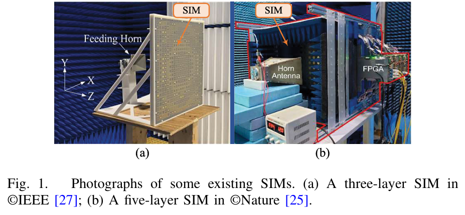
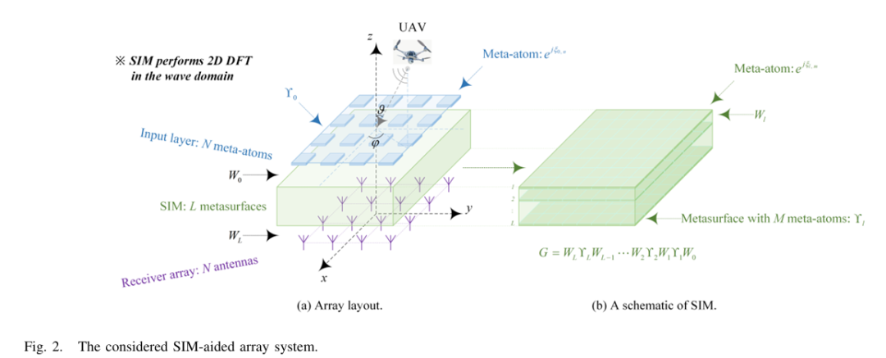
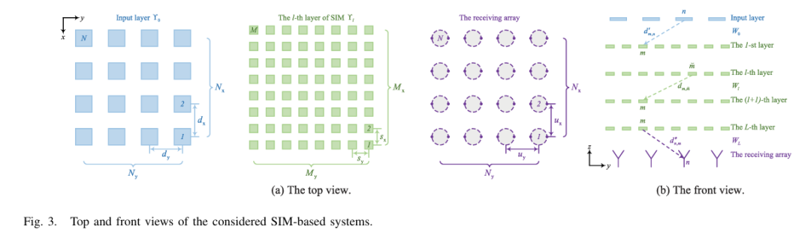
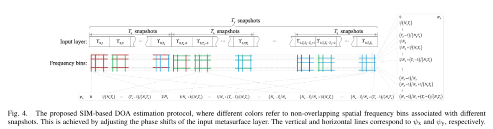
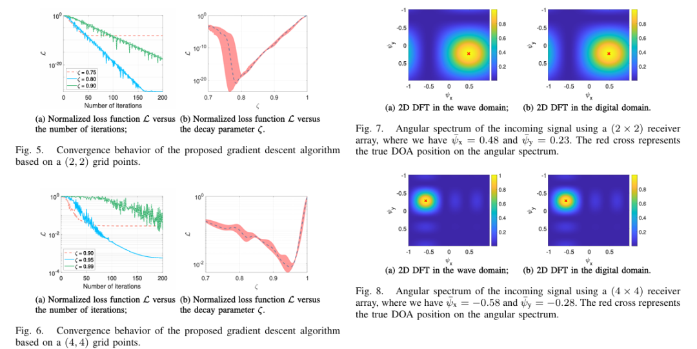
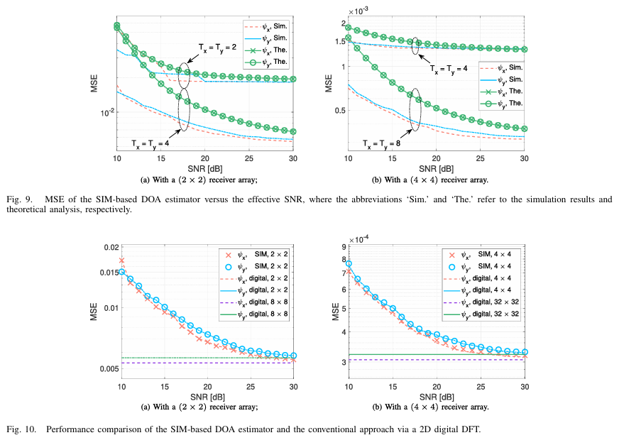
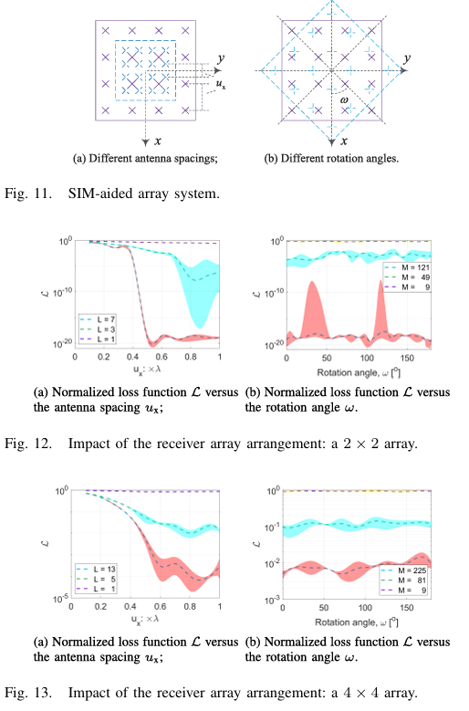

# DOA Estimation Using Stacked Intelligent Surfaces for Two-Dimensional Direction of Arrival Estimation [with MATLAB Code]

Introduction
For a long time, multi-antenna technology has been a key task in direction of arrival (DOA) estimation. It is widely used in astronomy, navigation, and emerging integrated sensing and communication systems for the sixth generation (6G) network [1], [2], [3], [4], [5], [6], [7], [8]. Traditionally, DOA is estimated using classical beamforming methods that can be effectively implemented by utilizing Fast Fourier Transforms [9], [10]. However, this method's angle resolution is fundamentally limited by the array aperture. The Rayleigh criterion indicates that only when the angle difference between two signal sources exceeds the antenna beam width can they be distinguished. To address this issue, several super-resolution DOA estimation methods have been developed [1], [2], [3], [4]. Two prominent techniques are Multi-Signal Classification (MUSIC) [1] and Estimating Signal Parameters via Rotation Invariance Technique (ESPRIT) [2]. Specifically, MUSIC utilizes the orthogonality between the signal and noise subspaces to construct the spatial spectrum, then identifies the DOA parameters of the received signals through spectral peak searches. Conversely, ESPRIT leverages the spatial rotation invariance of the signal subspace, avoiding spectral search and significantly improving computational efficiency. Since its inception, various modifications of the MUSIC and ESPRIT algorithms have been proposed for different scenarios [4]. For example, a statistical second-order algorithm was proposed in [12] for two-dimensional (2D) DOA estimation of coherent signals received by an uniform planar array (UPA). The authors arranged the signal correlation matrix into a block Hankel matrix and estimated its signal subspace using an approach similar to ESPRIT. Additionally, in [13], the authors combined an estimator based on parallel factor analysis with ESPRIT to study joint estimation of 2D DOA and transmit/receive polarization angles. Specifically, three-order structure information was utilized to achieve better performance.
Although these methods offer excellent performance advantages, they require substantial computational and storage resources for the feature value decomposition of the spatial covariance matrix. Furthermore, their performance significantly degrades when only a limited number of snapshots are available. Additionally, traditional DOA estimation methods typically assume ideal signal models and perfect antenna arrays, which are rarely applied in real-world systems. In fact, some deficiencies, such as non-ideal transceiver designs, station position errors, and background radiation, can significantly degrade the performance of parameterized methods. However, these deficiencies are difficult to precisely model and calibrate using traditional techniques [14] and [15].
Fortunately, advanced machine learning (ML) techniques constitute an effective alternative for estimating DOA. Compared to model-based methods, ML-based approaches are data-driven, thus capable of adapting to complex electromagnetic (EM) environments and being more robust to inevitable array imperfections. For instance, the authors in [16] introduced a two-step deep neural network (DNN) framework. Specifically, the multi-task autoencoder initially decomposes the input signal into multiple components, then employs a second stage composed of multiple parallel classifiers to reconstruct the angle domain spectrum, with enhanced robustness in estimating DOA. Additionally, the authors in [17] formulated the problem of DOA estimation from multiple sources as a multi-label classification problem. Specifically, the phase components of the short-term Fourier transform coefficients of the received signal are directly fed into a trained convolutional neural network (CNN) to estimate the position of the loudspeaker in dynamic acoustic scenarios. In [18], furthermore, a deep convolutional network (DCN) was designed to learn the transformation from undersampled array covariance matrices to angle spectra. Compared to traditional iterative sparse recovery methods that require complex iterations, the DCN framework offers superior computational efficiency. Leveraging sparsity can also improve the accuracy of DOA estimation. However, ML-based methods require a complex model training phase, leading to high hardware and computational complexity [16]. Obtaining a large training dataset covering all possible signal distributions is also challenging, especially in high Doppler scenarios.
In summary, the operation of a SIM card is as follows. When an EM wave illuminates the SIM, it interacts with each layer's superatoms and refracts through each layer. Specifically, each superatom applies a complex transmission coefficient to the impinging wave. According to Huygens-Fresnel principle [19], each superatom on the given layer acts as an auxiliary source, illuminating all the superatoms on the next layer. Additionally, at the meta-atom located at the given layer, all the EM waves transmitted by the meta-atoms from the previous layer are superimposed. This process continues in each supersurface layer of the SIM. Therefore, the forward propagation model of a SIM is equivalent to a fully connected artificial neural network, whose architecture can be reconfigured to implement complex signal processing functions and operations in the wave domain [25] and [26].
Generally speaking, SIMs are integrated communication and computing platforms that can efficiently perform general digital signal processing functions in the EM (wave) domain. In this context, several pioneering research works have emerged recently. Specifically, [25] authors experimentally evaluated the capabilities of SIM cards for image classification. They constructed a SIM prototype with five programmable metasurface layers and used it to recognize handwritten digits. Within the proposed hardware platform, the first metasurface layer serves as a Digital-to-Analog Converter (DAC), converting the input image into a grayscale image and configuring the transmission coefficients of the input layer to match the pixel values. The remaining four layers form the neural network for image recognition. Tests on the MNIST dataset showed that the optimized SIM achieved an accuracy of 90.76% in recognizing numbers from $0$ to $9$. In [26], the authors utilized SIMs for multi-input multi-output (MIMO) communication. Compared to traditional MIMO transceivers, two deployed SIMs at the transmitter and receiver can automatically complete transmit precoding and receiver combining when the EM waves pass through them. This allows direct radiation and recovery of each spatial stream from their respective transmit and receive ports, significantly reducing the number of required radio frequency (RF) chains. Additionally, in [29] and [30], the authors integrated SIMs into base stations (BSs) to facilitate downlink multi-user beamforming, eliminating the need for BSs to perform traditional digital beamforming and high-resolution DACs.
However, the use of SIM for DOA estimation has not yet been explored. Therefore, this paper is the first to design a new SIM-based DOA estimator in the wave domain. The fundamental idea is that by appropriately optimizing SIM to perform a 2D discrete Fourier transform (DFT), the incident electromagnetic wave can be converted into an angle domain when propagating through SIM. By detecting the energy levels of different receiver probes (each corresponding to a unique DOA), the direction of the incident signal can be inferred from the probe with the strongest detected energy. As a result, the receiver hardware is greatly simplified, as no analog-to-digital converter (ADC) is required. Most notably, compared to previous DOA estimators relying on array signal processing, the computations within SIM naturally occur without generating additional delays.
More specifically, the detailed contributions of this paper are summarized as follows:
We envisioned a SIM-based estimator to detect the DOA of a single source-emitted radio wave. The SIM consists of multiple supersurface layers, each containing a large number of small superstructure atoms with adjustable EM characteristics. By transmitting waves through these layers, SIM can naturally perform the required signal processing because each layer allows for faster transmission than traditional digital computations. By properly configuring SIM, we demonstrated that it can convert the incident radio wave into an angle domain. Therefore, the receiver array at the end of SIM can be used to detect the angle spectrum representation of the received signal. Specifically, we showed that by measuring the signal strength of each antenna in the receiver array, the DOA can be easily determined.
We have formulated an optimization problem aimed at minimizing the Frobenius norm of the error between the target 2D DFT matrix and the EM response of SIM, but each atom has a constant transmission amplitude. Finding the optimal configuration for SIM is not easy due to the non-convex formula and cascading structure of the end-to-end transfer function of SIM. To address this issue, we developed a gradient descent algorithm to iteratively update the phase of the SIM transmission coefficients to achieve the desired 2D DFT functionality.
When using a small number of receiver probes (antennas), the angle spectrum representation obtained at the output of SIM can provide a rough and networked estimate of DOA. To further improve the estimation accuracy of DOA, we suggest optimizing the phase shifts in multiple snapshots within the input layer of SIM to generate a set of 2D DFT matrices with mutual orthogonal spatial frequency intervals. This allows SIM to focus the energy of the given incident wave onto a specified grid of points, perfectly matching the incident direction because the strongest detection power corresponds to the target direction. The number of snapshots determines the trade-off between estimation accuracy and observation time.
We theoretically evaluated the performance of the proposed DOA estimator by deriving an upper bound on the Mean Square Error (MSE). Since the receiver array directly observes the angle spectrum of the incident signal, the proposed DOA estimator is fundamentally different from existing techniques that rely on phase-sensitive receivers and array signal processing. Moreover, using low-complexity energy detectors can significantly reduce hardware costs without affecting DOA estimation accuracy.
Article illustrations
Conclusion
A new SIM architecture has been proposed to estimate the 2D DOA parameters of individual radiation sources. This new design can significantly improve computational speed and reduce hardware complexity. By customizing the gradient descent method, the SIM is configured to compute the 2D DFT in the wave domain, where the incident electromagnetic waves automatically convert into their angle spectrum as they propagate through the SIM. Additionally, we have developed a protocol to generate a set of angle spectra with orthogonal spatial frequency intervals. Therefore, DOA can be estimated by searching for antennas with the strongest magnitude and snapshots. Furthermore, we have theoretically evaluated and numerically verified the MSE of the proposed SIM-based DOA estimator. A large number of simulation results have been provided to check the optimal SIM hardware parameters and hyperparameters of the gradient descent method.
As this is the first paper on SIM-assisted DOA estimation, there are still several open questions worth further exploration. First, it is necessary to further investigate how to utilize SIM technology to implement more complex DOA estimation algorithms, such as superresolution and compression sensor methods in the wave domain. It should also consider the general case of multiple signal sources. Second, by integrating amplifiers into each superatom and operating them in a nonlinear state, SIMs may be able to fully realize DNNs using electromagnetic waves for forward computation. The beneficial use of close-packed superatoms and supersurfaces for electromagnetic coupling can further enhance the generalization ability of SIMs. Moreover, utilizing deep reinforcement learning optimization strategies may help train SIMs by interacting with the environment [35]. Additionally, the transmission coefficients of each metaatom cannot be continuously adjusted in practice. Designing appropriate algorithms to optimize discrete phase shifts and evaluate performance under a more realistic superatom model is crucial. Considerations for the complex trade-off between the energy savings provided by SIMs and the penetration losses caused by multiple supersurface layers should be made at the system level [36].
Before concluding, it is noted that the inverse system of SIMs proposed in this paper can be utilized for angle division multiplexing. By employing SIM as a multi-user precoder in base stations, signals from each user can be transmitted directly from their respective antennas. This will significantly simplify the hardware design of wireless communication systems. Enthusiastic readers may find [26] and [29] to be interesting references. Additionally, near-field positioning supported by SIMs has been discussed in [37]. In summary, advanced SIM technology provides a new paradigm for computation through direct processing of electromagnetic waves, which will profoundly influence future system designs integrating wireless communication, radar sensing, and computational functions.

## Images

<!-- PAYMENT_BLOCK -->

## Get this dataset

- Payment link (Stripe): [Buy now](https://buy.stripe.com/3cs8yP7sY87d0vu9AB)
- Payment QR code: 

<!-- /PAYMENT_BLOCK -->
